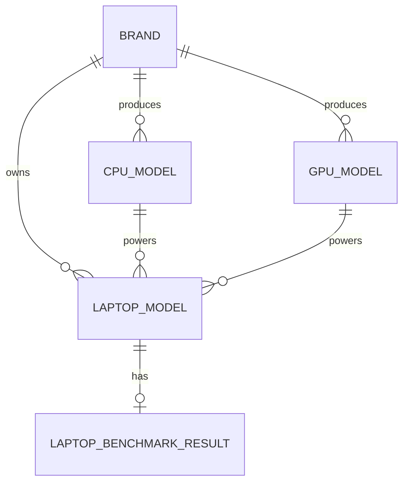
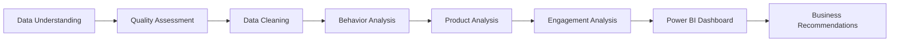

# LapLapTech User Behavior & Product Analysis

An exploratory data analytics project that combines laptop specifications, benchmark results, and website interaction logs to understand what users do on the LapLapTech platform and which product characteristics are associated with user interest.

> **Project status:** In progress  
> Current stage: data understanding, data quality assessment, exploratory analysis, and initial relationship analysis.

## Business Questions

This project focuses on three main questions:

1. How do users interact with the LapLapTech website?
2. Which laptop characteristics may be associated with higher user interest?
3. How are laptop specifications and benchmark performance related to user engagement?

Supporting questions include:

- Which search keywords, brands, and laptop models receive the most attention?
- Which products are frequently viewed or compared?
- Do gaming and non-gaming laptops show different engagement patterns?
- Are battery life and benchmark scores associated with higher interaction levels?

## Dataset Overview

The dataset contains six related tables covering product master data, hardware specifications, benchmark results, and user events.

| Table | Grain | Rows | Role |
|---|---|---:|---|
| `brand` | One row per brand | 20 | Dimension |
| `cpu_model` | One row per CPU model | 86 | Dimension |
| `gpu_model` | One row per GPU model | 56 | Dimension |
| `laptop_model` | One row per laptop model | 156 | Dimension |
| `laptop_benchmark_result` | One row per benchmark result | 152 | Fact-like table |
| `user_event_tracking` | One row per user event | 754,448 | Event fact table |

In total, the dataset contains **85 attributes and 754,918 records**. Most records come from `user_event_tracking`, which stores website events such as page views, searches, clicks, and product comparisons. Some event details are stored as JSON strings.

## Data Model

`laptop_model` is the central product table. It connects laptop products to their brands, CPU models, GPU models, and benchmark results.



The user-event table requires JSON extraction to identify event-specific information and create links between user behavior and laptop models.

## Data Quality Assessment

The initial assessment covers primary keys, foreign keys, missing values, duplicate records, data types, and numerical outliers.

### Completed checks

- All six `id` fields were verified as unique and non-null primary-key candidates.
- Six expected foreign-key relationships were tested using orphan-record checks.
- No orphan records were found in the tested relationships.
- No fully duplicated records were detected.
- Missing-value rates were measured for all attributes.
- Numerical outliers were identified using the Interquartile Range method.

### Issues requiring treatment

- `cpu_tdp` and `gpu_tdp` contain inconsistent numerical values and values with the `W` unit.
- `laptop_weight` may use inconsistent units; values such as `3600` and `3620` require validation.
- Zero values in weight and battery-capacity fields may represent missing information rather than real measurements.
- `thumbnail_image_url` contains image filenames rather than complete URLs.
- Several attributes have high missing-value rates and must be evaluated according to their analytical relevance.

Outliers are not removed automatically. Each unusual value is evaluated against related product attributes because extreme laptop specifications or benchmark scores may still be valid.

## Current Exploratory Findings

The findings below are preliminary and describe associations observed in the available data. They do not establish causal relationships.

### Product portfolio

- Non-gaming laptops represent approximately **69.9%** of the analyzed models, while gaming laptops represent approximately **30.1%**.
- Gaming laptops generally have a higher weight distribution than non-gaming laptops.
- ASUS has the largest number of laptop models in the dataset, followed by Lenovo and Apple.

### Gaming versus non-gaming engagement

- Non-gaming laptops recorded approximately **106,536 interactions**, compared with about **42,100 interactions** for gaming laptops.
- After normalizing by product count, non-gaming models averaged **977.4 interactions per laptop**, around 9.1% higher than the **895.4** average for gaming models.
- Engaged sessions per laptop were also higher for non-gaming models: **707.3** versus **643.4**.
- Detail page views account for approximately 70-71% of interactions in both product groups, while comparison interactions account for approximately 28.5-30%.

### Brand engagement

- Lenovo and ASUS recorded the highest total interaction volumes, at approximately **47.9K** and **47.1K** interactions respectively.
- Apple ranked next with approximately **19.8K** interactions.
- Total brand interactions must be interpreted together with the number of available models; a larger product portfolio may naturally produce more interactions.

### Battery and benchmark performance

- Gaming battery duration does not show a clear linear relationship with total product interactions.
- Geekbench 6 CPU Single-Core and Multi-Core scores do not show a clear relationship with engagement.
- GPU Compute scores show a noticeable negative pattern in the exploratory chart: several lower-scoring products received high interaction volumes, whereas many higher-scoring products received fewer interactions.
- These patterns suggest that benchmark performance alone does not explain product interest. Brand, product segment, design, price, and intended use may also influence engagement, although some of these factors are not available in the dataset.

## Analytical Workflow



## Tools and Techniques

- **Database:** ClickHouse
- **SQL client:** DBeaver
- **Analysis:** SQL and Python
- **Visualization:** Microsoft Power BI
- **SQL techniques:** joins, aggregations, CTEs, subqueries, window functions, and JSON extraction
- **Data-quality techniques:** null analysis, duplicate checks, referential-integrity checks, type validation, and IQR-based outlier detection

## Repository Structure

```text
laplaptech-user-behavior-product-analysis/
├── data/
│   ├── raw/                  # Local only; excluded from GitHub
│   └── README.md             # Dataset description and access notes
├── sql/                      # SQL exploration and analysis queries
├── notebooks/                # Python and Jupyter analysis
├── reports/                  # Project reports
├── dashboard/                # Power BI files
├── images/
│   ├── charts/               # Exported analytical charts
│   └── diagrams/             # ERD and process diagrams
├── .gitignore
└── README.md
```

## Project Roadmap

- [x] Define the project context, scope, and business questions
- [x] Review the dataset structure and table grain
- [x] Validate primary-key and foreign-key candidates
- [x] Assess missing values, duplicates, data types, and outliers
- [x] Complete initial product and engagement exploration
- [ ] Standardize inconsistent units and invalid zero values
- [ ] Parse JSON fields in the user-event data
- [ ] Analyze page views, searches, clicks, and comparisons
- [ ] Analyze activity trends, sessions, devices, and search keywords
- [ ] Develop reproducible SQL and Python analysis files
- [ ] Build the Power BI data model and dashboard
- [ ] Finalize business insights, recommendations, and limitations

## Data Availability and Attribution

The original data is not included in this repository because public redistribution permission and licensing have not been verified. The repository will contain only the author's analysis code, documentation, visualizations, aggregated results, and appropriately anonymized samples where permitted.

The dataset was described as a snapshot from the **LapLapTech** laptop-comparison platform and was shared by **Nguyễn Ngọc Duy Luân**. All analysis and interpretations in this repository are the work of the repository author.

## Limitations

- The available data supports observational analysis, not causal conclusions.
- Product interaction can be influenced by variables that are absent from the dataset, including price, promotions, traffic sources, availability, and page placement.
- Brands and product categories have different numbers of models, so total interactions should not be interpreted without normalized metrics.
- Missing values, inconsistent units, and possible tracking anomalies may affect individual analyses.
- User and session identifiers must be handled carefully and are not published in the repository.

## Author

**Mai Tran**  
Aspiring Data Analyst / Business Analyst

---

This README will be updated as the analysis and dashboard are completed.
